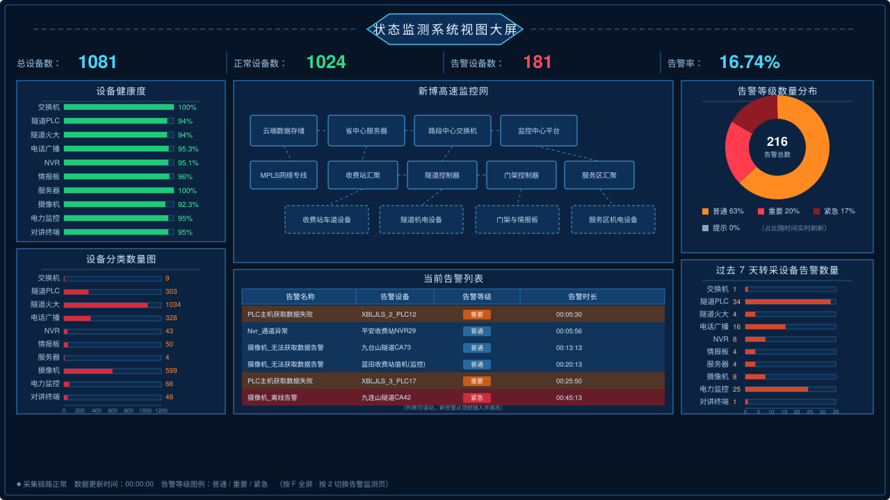
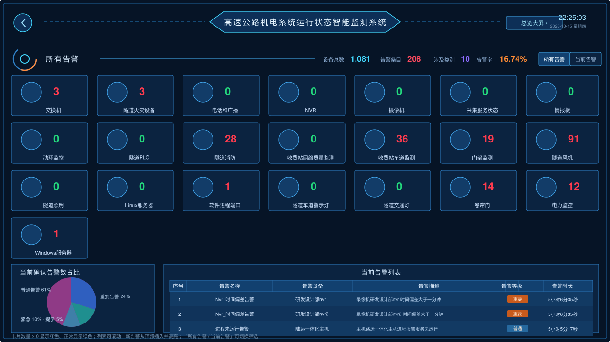

# 高速公路机电系统运行状态智能监测平台

纯静态网页（HTML + CSS + 原生 JS，零外部依赖、可离线运行），按设计稿还原两个页面：

| 页面 | 文件 | 对应设计 |
| --- | --- | --- |
| 告警监测页（首页入口之一） | `alarms.html` | 高速公路机电系统运行状态智能监测系统 |
| 总览大屏 | `index.html` | 状态监测系统视图大屏 |

两页可互相跳转：大屏右上角「告警监测 ›」，告警页左上角返回按钮 / 右上角「总览大屏 ›」。

## 项目文档

- [原型文档](docs/原型文档.md)：项目背景与目标、使用角色、告警等级口径、页面原型与交互说明、
  视觉规范、数据模型与接口约定、后续迭代规划

## 界面原型

**总览大屏**（KPI · 设备健康度 · 监控网拓扑 · 告警等级分布 · 7 天告警 · 当前告警列表）



**告警监测页**（22 类设备告警卡片 · 确认告警占比 · 告警明细列表）



## 打开方式

直接双击 `index.html`（或 `alarms.html`）即可用浏览器打开；无需安装任何环境、无需联网。

如需局域网内其它电脑访问，可在本目录执行任意静态服务器，例如：

```bash
python3 -m http.server 8791
# 浏览器访问 http://127.0.0.1:8791/index.html
```

## 页面内容

**总览大屏 `index.html`**

- 顶部 KPI：总设备数 1081 / 正常设备数 1024 / 告警设备数 181 / 告警率 16.74%
- 左列：设备健康度（绿色条形图）、设备分类数量图（红色条形图 + 坐标轴）
- 中列：新博高速监控网拓扑图（SVG 绘制，链路带流动动效）、当前告警列表
- 右列：告警等级数量分布（立体环形图 + 图例）、过去 7 天转采设备告警数量
- 底部：采集链路状态、数据更新时间、告警等级图例

**告警监测页 `alarms.html`**

- 22 类设备告警卡片（数量 > 0 显示红色，正常显示绿色）
- 右侧统计：设备总数、告警条目、涉及类别、告警率
- 左下：当前确认告警数占比（实心饼图 + 引导线标签 + 图例）
- 右下：当前告警列表（序号 / 告警名称 / 告警设备 / 告警描述 / 告警等级 / 告警时长）
- 「所有告警 / 当前告警」切换按钮可筛选列表

## 实时效果

页面内置模拟数据源（`assets/js/data.js`），演示时具有实时感：

- 告警时长每秒累加
- 周期性推送新告警并刷新列表、告警等级占比
- 设备健康度轻微波动

接入真实数据时，把 `data.js` 中的模拟数据替换为接口 / WebSocket 推送即可，
图表渲染接口（`SR.hbars`、`SR.donut`、`SR.topology`）保持不变。

## 快捷键

- `F`：全屏（大屏值守推荐）
- `1`：切换到总览大屏
- `2`：切换到告警监测页

## 目录结构

```
监测平台/
├─ index.html                 总览大屏
├─ alarms.html                告警监测页
└─ assets/
   ├─ css/
   │  ├─ base.css             深色科技主题、面板、标题栏、大屏缩放
   │  ├─ screen.css           总览大屏布局与图表样式
   │  └─ alarms.css           告警页布局与卡片 / 明细表样式
   └─ js/
      ├─ util.js              缩放适配、星空背景、图标库、格式化、时钟
      ├─ data.js              模拟数据（接口替换点）
      ├─ charts.js            条形图 / 立体环形图 / 标签饼图 / 网络拓扑
      ├─ screen.js            总览大屏逻辑
      └─ alarms.js            告警页逻辑
```

## 适配说明

页面以 1920 × 1080 为设计基准，通过整体等比缩放自动适配任意屏幕尺寸与分辨率
（4K、2K、1080P、笔记本屏幕、投屏），不会出现错位或滚动条。
